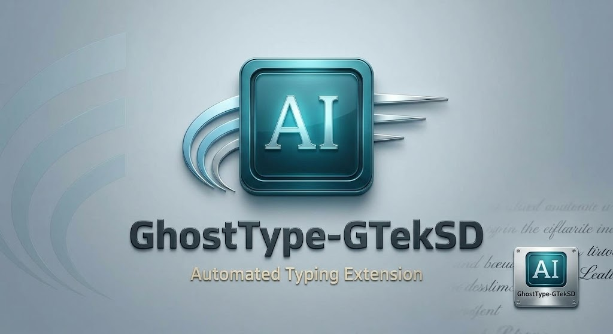

# GhostType - GTekSD

<p align="center">
  
</p>

GhostType is a browser extension for automated text entry into supported web-page editors. Prepare multiple text snippets, choose a typing speed, and send a snippet to a focused field or, where supported, a canvas-based input that handles keyboard events.

## Install GhostType

- [Install from the Chrome Web Store](https://chromewebstore.google.com/detail/ghosttype-gteksd/mkjcmmdggkpodgdoopjmhmmoidonkfej?hl=en)
- [Install from Firefox Browser Add-ons](https://addons.mozilla.org/en-US/firefox/addon/ghosttype-gteksd/)

### Microsoft Edge

Edge supports Chromium extensions. To load GhostType locally:

1. Download or clone this repository and extract it if downloaded as an archive.
2. Open `edge://extensions` and enable **Developer mode**.
3. Select **Load unpacked** and choose the project folder containing `manifest.json`.
4. Open a web page, then open GhostType from the browser toolbar or side panel.

The Edge Add-ons package can also be built with `.\edge\build.ps1` in PowerShell.

## How to use GhostType

1. Open the extension side panel on the page where you want to type.
2. Enter text in one of the three **Text Snippets**. Use **+** to add more snippets, **−** to remove extra snippet fields, or **Clear all** to empty every snippet while keeping the fields.
3. Click the target field on the web page so it is ready to receive text.
4. Adjust **Speed** if desired. **Human** mode optionally adds pauses and simulated corrections.
5. Select **Start** on the snippet you want to type. Use **Stop** to end the current run. **Paste** reads clipboard text into that snippet when you select it; **Clear** empties only that snippet.

### Canvas-based editors

Canvas Mode is intended for pages that implement their own keyboard-driven canvas input. It does not make arbitrary canvases editable.

1. Turn on **Canvas mode** in the extension panel.
2. Click the target canvas on the web page.
3. Select **Start** on the snippet you want to send.
4. Turn Canvas Mode off again before typing into ordinary text fields.

The page must implement a keyboard event handler that accepts the dispatched events. A canvas that only displays pixels, or an application that rejects synthetic events, will not accept GhostType input.

## Try the security lab

You can explore how different client-side input restrictions behave in the [GTekSD Security Lab: Clipboard Restriction Suite](https://gteksd.github.io/clipboard_restriction_security_lab.html). It is a testing sandbox, not a guarantee that every restriction can be overcome. Its six demonstrations are:

1. **JavaScript event listener:** blocks native paste, copy, or cut events with `preventDefault()`.
2. **Inline HTML handlers:** uses attributes such as `onpaste="return false"` to cancel clipboard actions.
3. **Keyboard shortcut interceptor:** listens for shortcut keys such as Ctrl+V, Cmd+V, or Shift+Insert and cancels them.
4. **Context menu and selection blocker:** disables the context menu and text selection with event handlers and CSS.
5. **Dynamic mutation and cleansing:** clears or sanitizes a field after a paste event, including asynchronously.
6. **Canvas virtual input:** has no text input element; the page draws text into a canvas in response to keyboard events.

The lab lets you toggle methods, interact with their test surfaces, and inspect the event terminal for recorded activity. Follow the instructions on the lab itself and use it only for authorized testing.

## How GhostType works

Browser extensions cannot produce trusted physical keystrokes from ordinary JavaScript. GhostType runs a content script on the active web page and routes typing commands from the panel through the extension background service worker.

- For standard `<input>` and `<textarea>` fields, GhostType updates the field value and dispatches an `input` event so many page frameworks can observe the change.
- For `contenteditable` areas, it uses browser editing commands to insert text.
- For supported Google Docs input, it dispatches synthetic keyboard events to the editor's event target.
- In Canvas Mode, it targets the last canvas clicked and dispatches synthetic `keydown`, `keypress`, and `keyup` events. The page's own handler must respond to those events and render the text.

Synthetic events have `isTrusted === false`. Websites and editors may reject or ignore them, and behavior varies by site. Canvas Mode does not read or alter the canvas bitmap, inspect or modify a page's JavaScript state, defeat access controls, or guarantee compatibility with custom editors.

## Fonts

GhostType uses the Inter and JetBrains Mono fonts to match the typography of the GTekSD Security Lab. Font files are bundled locally so the extension does not need to contact an external font service. The fonts are distributed under the SIL Open Font License 1.1; the copyright notices and licenses are included in `fonts/`.

## Build packages locally

Run these commands from the project directory in PowerShell:

```powershell
.\chrome\build.ps1
.\edge\build.ps1
.\firefox\build.ps1
```

The scripts create browser-specific ZIPs in the parent directory. Chrome and Edge use the Chromium extension files; the Edge package removes Chrome-specific manifest fields. Firefox uses its own manifest and background script.

To load the Firefox build temporarily, extract the generated ZIP, open `about:debugging`, select **This Firefox** → **Load Temporary Add-on**, and choose the extracted `manifest.json`.

## Privacy and permissions

GhostType stores its snippets and settings locally in the extension panel. Clipboard contents are read only when you select **Paste**. Typing commands are sent to the active tab where you choose to run them. See [PRIVACY.md](./PRIVACY.md) for details.

## Development

The extension is built with browser extension APIs and plain JavaScript, HTML, and CSS. For local development, load the project folder as an unpacked extension in a Chromium browser. Website and editor compatibility can vary.

## Contributing

Contributions are welcome. To propose a change:

1. Open an issue describing the problem or feature, or comment on an existing issue before starting larger changes.
2. Fork the repository and create a branch for your work.
3. Keep changes focused, follow the existing code style, and update the README when behavior or setup instructions change.
4. Test the affected browser build locally. When appropriate, run the package scripts above and verify the extension in the target browser.
5. Open a pull request with a clear summary, the reason for the change, and the tests you performed. Include screenshots for user-interface changes.

Please avoid including personal data, credentials, or unrelated generated files in issues and pull requests. Changes must respect the documented privacy and security limitations; synthetic events must not be described as trusted physical keystrokes or guaranteed to work on every site.
